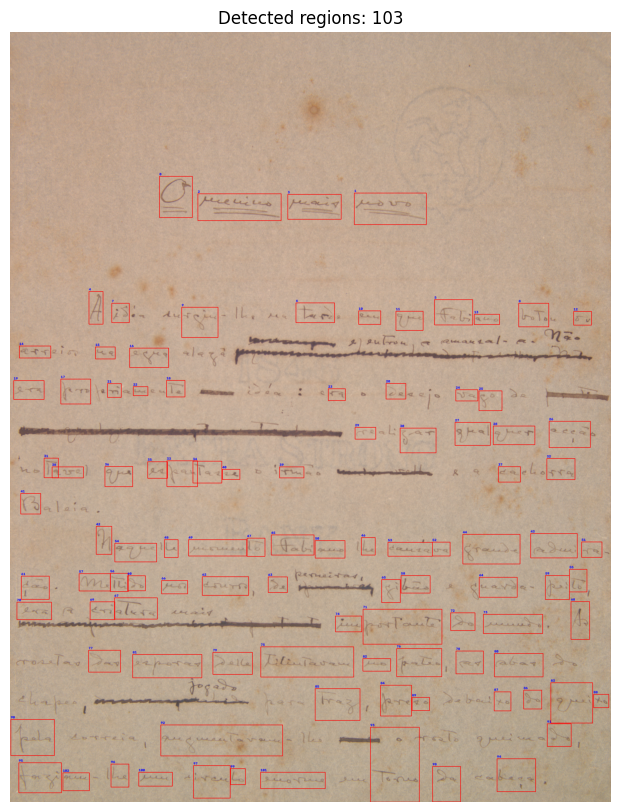

# Building the Synthetic Dataset

## Overview

Following the new direction discussed in Week 17, I started working on the synthetic dataset that will be used to train our generative model. Since we do not have ground-truth images of the text hidden by strike-through, the idea is to build a set of synthetic examples from text that is already visible in our manuscript images.

The first step was to implement a pipeline for extracting valid text regions from manuscript images. This post focuses on that preprocessing stage.

## Extracting Text Regions

I implemented a text extraction pipeline based on classical image processing techniques. The first step is thresholding, which separates potential text pixels from the background. I then used connected-component analysis to identify groups of connected pixels and extract their bounding boxes: most of which are isolated letters.

However, since I want to extract complete words rather than isolated letters, I applied morphological dilation using an elliptical structuring element. This expands the components and merges nearby ones, causing close letters (which probably belong to the same word) to be grouped into a single bounding box.

After merging the components, I filtered them based on their size. This step helps remove unwanted noisy regions, such as mold, that could otherwise be mistaken for text.

Finally, I introduced an additional filter based on pixel intensity variance. My goal was to use this filter to remove words that are crossed-out, as none of the previous steps actually check if the component is visible text. 

The motivation for the filter comes from our observations that strike-through is slightly darker than the underlying text. As a result, components containing strike-through tend to exhibit greater intensity variance than those containing only visible text. This difference is used to filter out components that are likely to contain crossed-out text (components with high variance).

The following image shows an example of our algorithm:

## Next Steps

With the initial text extraction pipeline implemented, the next step is to use the extracted regions to construct the synthetic dataset. This will involve adding synthetic strike-throughs, which we'll cover next week.

---

*Research supported by FAPESP.*
