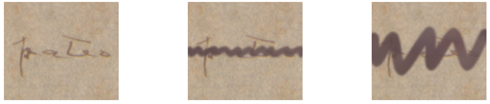

# Week 20 - Simulating Strike-through

## Overview

Following the implementation of the text extraction pipeline in Week 19, I spent this week working on the next step of the synthetic dataset: simulating strike-through over visible text.

The goal is to create synthetic examples in which we know what the original text looks like before it is crossed out. To make these examples useful for training a generative model, however, the synthetic strike-through needs to resemble real pen strokes in both shape and appearance.

## Generating Strike-through

I implemented a generator that creates a strike-through mask for a given text bounding box. The mask defines the geometry of the stroke independently of its color, allowing me to control its shape and appearance separately.

The stroke is represented by a sequence of alternating peaks and troughs across the text region. I then interpolate between these points using a Catmull-Rom spline, which produces a smoother curves instead of connecting the points with straight lines.

To make the generated strokes less uniform, I introduced several parameters that control their geometry. These include the regularity of the point spacing, the vertical amplitude of the zigzag, the stroke thickness, and the smoothness of the curve. This is intended to better approximate the asymmetry of real handwriting and strike-through.

Another reason for the amount of parameters is that they can serve for data augmentation.

The generator also allows the stroke to extend slightly beyond the text bounding box. This avoids producing strokes that begin or end exactly at the edges of the text region.

## Simulating Ink Appearance

After generating the geometric mask, the next step is to apply the strike-through to the original image. Rather than using a uniform color, I implemented a coloring function that introduces variation in both color and ink density.

The function can estimate the color variation of the existing text and use it to guide the appearance of the synthetic ink. It also generates smooth noise fields to introduce local variations in color and opacity. Finally, the mask is blurred slightly around its edges to simulate a gradual transition between the ink and the underlying image. This is done to simulate the pixels at the borders of text/strike-through, as they seem lighter in most images in our dataset.

The following image shows an example of synthetic strike-through for two combination of parameters:

## Current Limitations

Although the geometric and coloring components are now implemented, the generator still needs further refinement. In particular, I need to work on the generated colors, so that they resemble real ink more closely. Stroke shapes also still need a bit of work to adequately represent the variations found in actual manuscripts.

For now, the implementation provides a flexible starting point for generating synthetic strike-through. The next step is to compare the generated examples with real manuscript images and adjust the parameters accordingly.

## Next Steps

I will continue refining the synthetic strike-through generator, focusing on its color and potentially its geometry. Once the results are sufficiently realistic, I can integrate it into the synthetic dataset pipeline and move closer to training the generative model.

---

*Research supported by FAPESP.*
